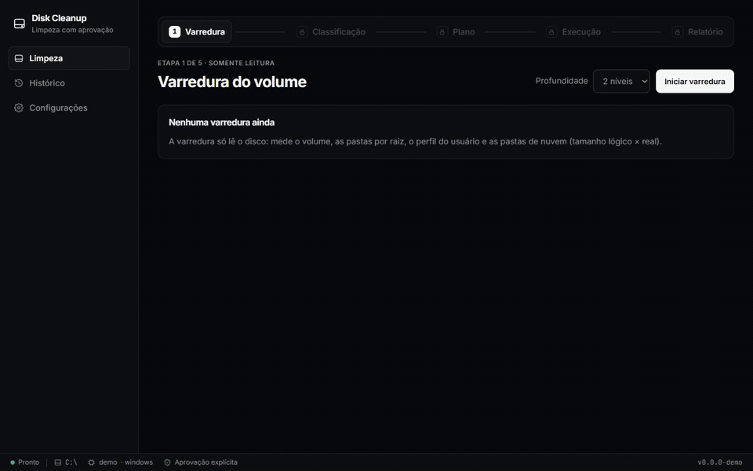

<h1 align="center">
   Disk Cleanup
</h1>

<p align="center">
  
  
  
  
  
</p>

<p align="center">
  <sub><b>English</b> · <a href="README.pt-BR.md">Português (Brasil)</a></sub>
</p>

<h2 align="center">Turn "my disk is full" into a verifiable plan.</h2>

<p align="center">
  Measures the whole volume in one parallel pass, tells real disk usage from cloud placeholders,
  classifies what is safe to clean and builds a reviewable plan. Nothing is deleted without
  measurement and explicit approval.
</p>

<h3 align="center"><a href="../../releases"><ins>Download</ins></a> &nbsp;·&nbsp; <a href="docs/architecture.md"><ins>Architecture →</ins></a></h3>

<p align="center">
  
</p>

## Features

<table>
<tr>
<td width="50%" valign="middle">

### Volume survey

One parallel walk of the whole volume aggregates every view at once: roots, second level and the
user profile. Cloud folders (OneDrive, Google Drive, Dropbox, iCloud) show **logical × real** size,
so 60 GB of placeholders are not mistaken for 60 GB on disk. Unreadable folders are counted, not
hidden.

</td>
<td width="50%">
  
</td>
</tr>
<tr>
<td width="50%" valign="middle">

### Classification and plan

A data-driven catalog (`catalog/windows.toml`) turns paths into candidates in four tiers — cache,
uninstall, regenerable directories, system. Mandatory exclusions (`Windows\Installer`, `WinSxS`,
`Package Cache`…) can never enter a plan, and a tool still referenced by `PATH` or a watched
variable (e.g. `CUDA_PATH`) is **blocked**. The plan exports a `plan.json`.

</td>
<td width="50%">
  
</td>
</tr>
<tr>
<td width="50%" valign="middle">

### Light and dark

A neutral, professional look in both themes. It follows the system preference and remembers your
choice.

</td>
<td width="50%">
  
</td>
</tr>
<tr>
<td width="50%" valign="middle">

### Tested by design

Clean architecture in Rust (domain → application → infrastructure) and Vue, built test-first.
Coverage gates fail the build below 95%: today the Rust core sits at 98% of lines and the UI at
100%.

</td>
<td width="50%">
  
</td>
</tr>
</table>

## Status

| Step | State |
|---|---|
| 1. Survey | done |
| 2. Classification | done (Windows catalog, tiers A and C) |
| 3. Plan | done — `plan.json` in the format of the `disk-cleanup` skill |
| 4. Execution · 5. Report | next phase |

The user interface is in Brazilian Portuguese for now.

## Install

Packages are built **only by GitHub Actions** and attached to each release.

| OS | Package |
|---|---|
| Windows x64 | `disk-cleanup_X.Y.Z_windows_x64-setup.exe` (per-user, no admin prompt) |
| Linux x64 | `.deb`, `.rpm` or `.AppImage` (Ubuntu 22.04+ / equivalent) |
| macOS | `.dmg` for Apple Silicon (`arm64`) or Intel (`x64`) |

The macOS image is not signed with an Apple Developer ID: on first launch, right-click the app and
choose **Open**.

## Developing

Requirements: Rust stable, Node 20+ and pnpm. Local work is tests and coverage — **no packages are
built on a developer machine**.

```bash
# Rust core
cargo test --workspace
cargo cov --summary-only        # fails below 95% of lines
cargo clippy --workspace --all-targets -- -D warnings

# UI (apps/desktop)
pnpm install
pnpm test
pnpm coverage                   # fails below 95%
pnpm typecheck
pnpm dev                        # UI in the browser with demo data
```

Regenerate the README media (demo data, recorded with the installed Edge):

```bash
cd apps/desktop
pnpm exec vite build && pnpm exec vite preview --port 4173 &
node scripts/record-readme-media.mjs http://localhost:4173 ../../docs/assets/readme
```

Workflow: test first (red), minimal code (green), refactor. See [docs/architecture.md](docs/architecture.md).

## Releases

A release is an annotated tag on `main`; the version comes from the tag. The Claude Code skills
`disk-cleanup-release` (stable) and `disk-cleanup-release-beta` (beta channel) cut the tag and follow
the `Release Desktop Packages` workflow, which builds every OS, verifies, and publishes. Details and
the auto-update analysis: [docs/release.md](docs/release.md).

## License

Proprietary — all rights reserved.
