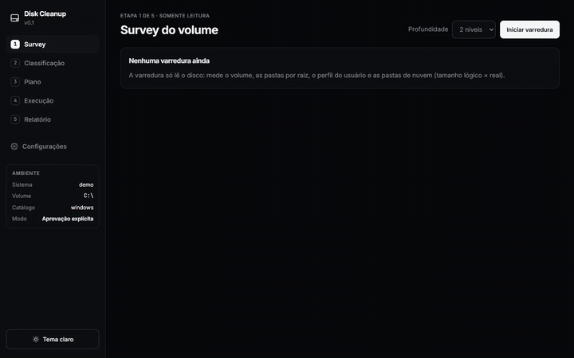
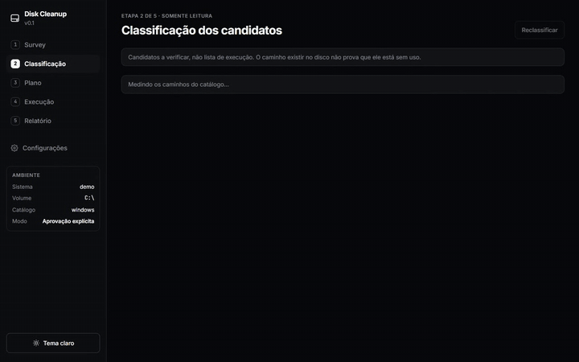
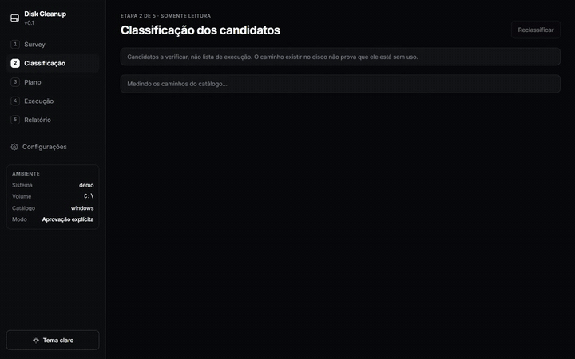
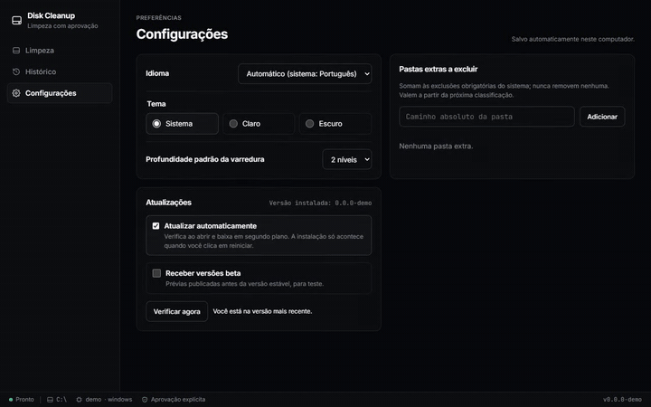
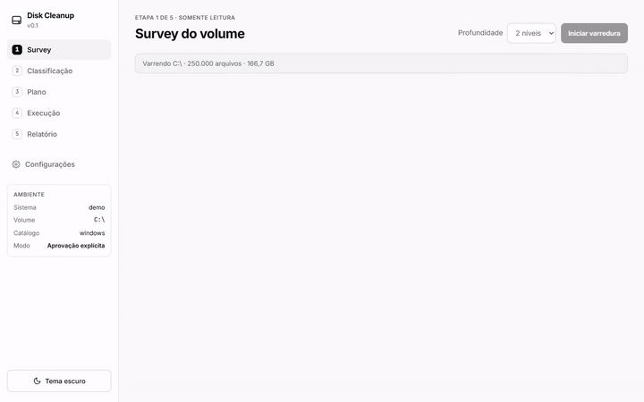
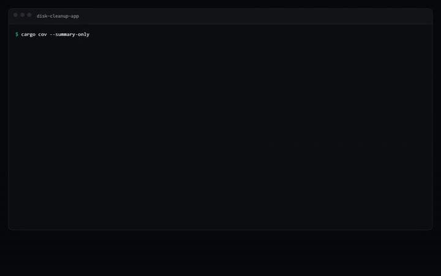

<h1 align="center">
   Disk Cleanup
</h1>

<p align="center">
  <a href="LICENSE"></a>
  <a href="https://github.com/edilsonvilarinho/disk-cleanup-app/releases"></a>
  <a href="https://github.com/edilsonvilarinho/disk-cleanup-app/actions/workflows/ci.yml"></a>
  
</p>

<p align="center">
  
  
  
  
</p>

<p align="center">
  <sub><b>English</b> · <a href="README.pt-BR.md">Português (Brasil)</a></sub>
</p>

<h2 align="center">Turn "my disk is full" into a verifiable plan.</h2>

<p align="center">
  Measures the whole volume in one parallel pass, tells real disk usage from cloud placeholders,
  classifies what is safe to clean, builds a reviewable plan and executes it tier by tier. Nothing is deleted without
  measurement and explicit approval.
</p>

<h3 align="center"><a href="../../releases"><ins>Download</ins></a> &nbsp;·&nbsp; <a href="docs/architecture.md"><ins>Architecture →</ins></a></h3>

<p align="center">
  
</p>

## Features

<table>
<tr>
<td width="50%" valign="middle">

### Volume survey

One parallel walk of the whole volume aggregates every view at once: roots, second level and the
user profile. While it runs you see files read, logical size, elapsed time and the live rate
(files/s) — no fake percentage, since the total is unknown until the walk ends. Cloud folders
(OneDrive, Google Drive, Dropbox, iCloud) show **logical × real** size, so 60 GB of placeholders are
not mistaken for 60 GB on disk. Unreadable folders are counted, not hidden.

</td>
<td width="50%">
  
</td>
</tr>
<tr>
<td width="50%" valign="middle">

### Classification and plan

A data-driven catalog (`catalog/windows.toml`) turns paths into candidates in four tiers — cache,
uninstall, regenerable directories, system. Mandatory exclusions (`Windows\Installer`, `WinSxS`,
`Package Cache`…) can never enter a plan, and a tool still referenced by `PATH` or a watched
variable (e.g. `CUDA_PATH`) is **blocked**. The plan fits one screen: the tiers that will run and
the review confirmation sit right under **Approve** (clicking it early points at what is missing),
items are grouped per tier, and the `plan.json` opens in a side drawer.

</td>
<td width="50%">
  
</td>
</tr>
<tr>
<td width="50%" valign="middle">

### Execution and report

Execution is guided one tier at a time: **Run tier X** stays at the top, a step card says what to
do next (step k of n) and holds the confirmation, and a timeline keeps the current tier open with its
dry-run while finished tiers collapse into their results. Watch every item run with the free space
measured before and after it. A locked file never aborts the tier — it becomes a pending item.
Removal never follows symlinks or junctions, and broad or protected folders (volume root, profile,
`Program Files`…) are refused even if the catalog asks. The report compares measured × estimated
per tier, lists divergences and pending items, and copies as Markdown.

</td>
<td width="50%">
  
</td>
</tr>
<tr>
<td width="50%" valign="middle">

### Settings and languages

English and Portuguese across the whole app — including the reasons and errors that come from the
Rust core, which now speaks in codes the UI translates. **Automatic** follows the system language.
Theme follows the system or stays light/dark, extra folders can be protected on top of the mandatory
exclusions, and the default scan depth is remembered. A status bar at the bottom of the window shows
what is running, the volume, the approval mode, the version and any update.

</td>
<td width="50%">
  
</td>
</tr>
<tr>
<td width="50%" valign="middle">

### Light and dark

A neutral, professional look in both themes. It follows the system preference or your choice in
Settings, and the switch reveals the new theme in a circle from where you clicked.

</td>
<td width="50%">
  
</td>
</tr>
<tr>
<td width="50%" valign="middle">

### Tested by design

Clean architecture in Rust (domain → application → infrastructure) and Vue, built test-first.
Coverage gates fail the build below 95%: today the Rust core sits at 98.9% of lines (99 tests) and
the UI at 99.1% of lines (169 tests).

</td>
<td width="50%">
  
</td>
</tr>
</table>

## Status

| Step | State |
|---|---|
| 1. Scan (survey) | done |
| 2. Classification | done — catalogs for Windows, Linux and macOS (tiers A and C) |
| 3. Plan and approval | done — `plan.json` in the format of the `disk-cleanup` skill |
| 4. Execution | done — paths and commands; uninstallers (tier B), DISM and an elevated helper are next |
| 5. Report | done — copies as Markdown |

Each OS has its own bundled catalog (`catalog/windows.toml`, `linux.toml`, `macos.toml`) and its own
mandatory exclusions (system folders, package databases, keychains, iCloud Drive, device backups).
The Linux and macOS catalogs follow the platforms' documented paths and still need validation on real
machines.

## Install

Packages are built **only by GitHub Actions** and attached to each release.

| OS | Package |
|---|---|
| Windows x64 | `disk-cleanup_X.Y.Z_windows_x64-setup.exe` (per-user, no admin prompt) |
| Linux x64 | `.deb`, `.rpm` or `.AppImage` (Ubuntu 22.04+ / equivalent) |
| macOS | `.dmg` for Apple Silicon (`arm64`) or Intel (`x64`) |

The macOS image is not signed with an Apple Developer ID: on first launch, right-click the app and
choose **Open**.

## Developing

Requirements: Rust stable, Node 20+ and pnpm. Local work is tests and coverage — **no packages are
built on a developer machine**.

```bash
# Rust core
cargo test --workspace
cargo cov --summary-only        # fails below 95% of lines
cargo clippy --workspace --all-targets -- -D warnings

# UI (apps/desktop)
pnpm install
pnpm test
pnpm coverage                   # fails below 95%
pnpm typecheck
pnpm dev                        # UI in the browser with demo data
```

Regenerate the README media (demo data, recorded with the installed Edge):

```bash
cd apps/desktop
pnpm exec vite build && pnpm exec vite preview --port 4173 &
node scripts/record-readme-media.mjs http://localhost:4173 ../../docs/assets/readme
```

Workflow: test first (red), minimal code (green), refactor. See [docs/architecture.md](docs/architecture.md).

## Releases

A release is an annotated tag on `main`; the version comes from the tag. The Claude Code skills
`disk-cleanup-release` (stable) and `disk-cleanup-release-beta` (beta channel) cut the tag and follow
the `Release Desktop Packages` workflow, which builds every OS, verifies, and publishes.

**Auto-update** is on by default: the app checks on launch, downloads in the background and installs
only when you click **Restart and update**. Every update is verified against a minisign signature.
Beta versions are opt-in (Settings → Updates → *Receive beta versions*). Details:
[docs/release.md](docs/release.md).

## Related projects

Disk Cleanup sits between disk-usage analyzers and cleaners. Projects worth knowing, and where they
differ:

| Project | Focus | Difference from Disk Cleanup |
|---|---|---|
| [tw93/Mole](https://github.com/tw93/Mole) | macOS/Windows cleaner, CLI + native apps | Deletes per command with `--dry-run`; no approvable plan or per-tier report |
| [qarmin/czkawka](https://github.com/qarmin/czkawka) | Duplicates, empty folders, similar images | Finds redundant user files; does not classify caches or toolchains |
| [bootandy/dust](https://github.com/bootandy/dust) · [Byron/dua-cli](https://github.com/Byron/dua-cli) · [dundee/gdu](https://github.com/dundee/gdu) | Terminal disk-usage analyzers | Measure and (dua/gdu) delete by hand; no safety catalog |
| [voidcosmos/npkill](https://github.com/voidcosmos/npkill) · [tbillington/kondo](https://github.com/tbillington/kondo) | Project artifacts (`node_modules`, `target`…) | Scoped to project folders, not the whole volume |
| [bleachbit/bleachbit](https://github.com/bleachbit/bleachbit) | System cleaner for Windows and Linux | Cleaner definitions in XML (CleanerML); no approved per-tier plan |
| [windirstat/windirstat](https://github.com/windirstat/windirstat) · [adileo/squirreldisk](https://github.com/adileo/squirreldisk) | Treemap / sunburst visualization | Visual exploration first; cleanup is manual |

## License

[MIT](LICENSE) © 2026 Edilson Souza.
