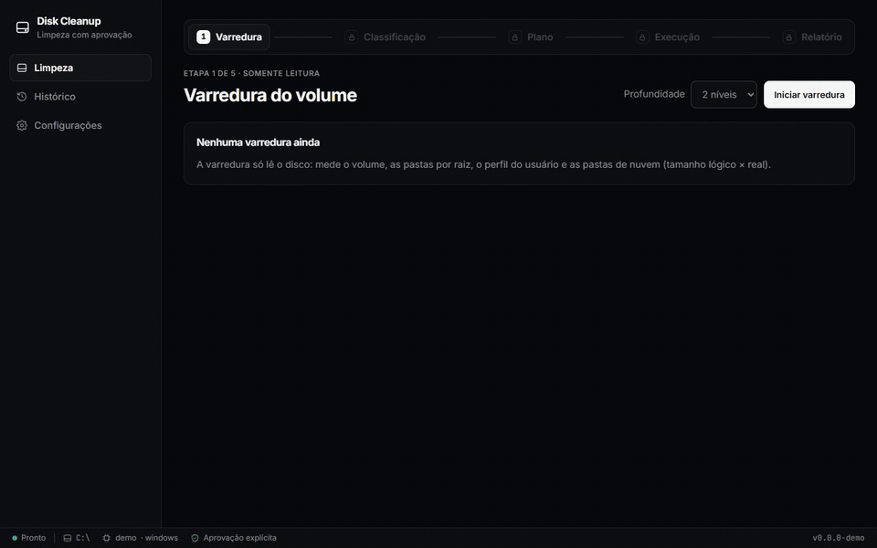
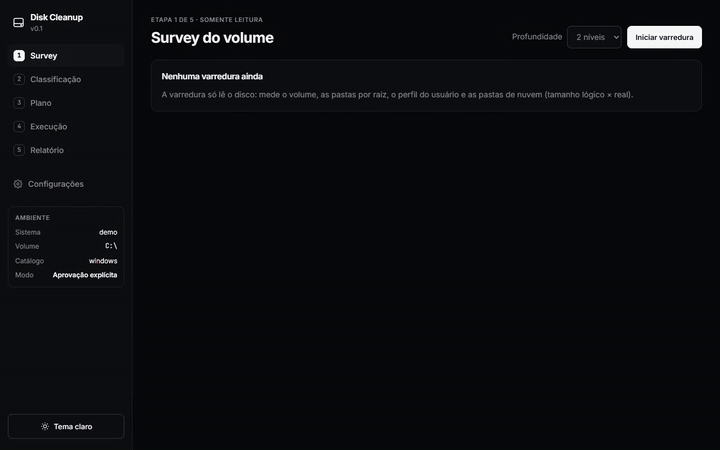
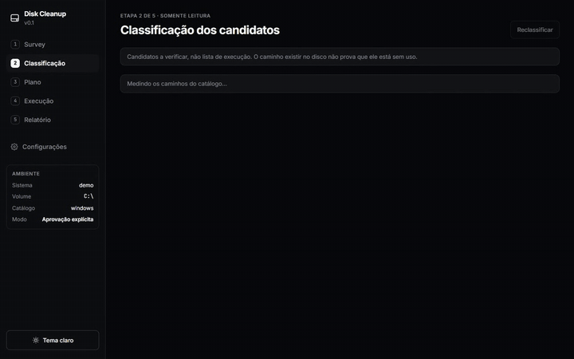
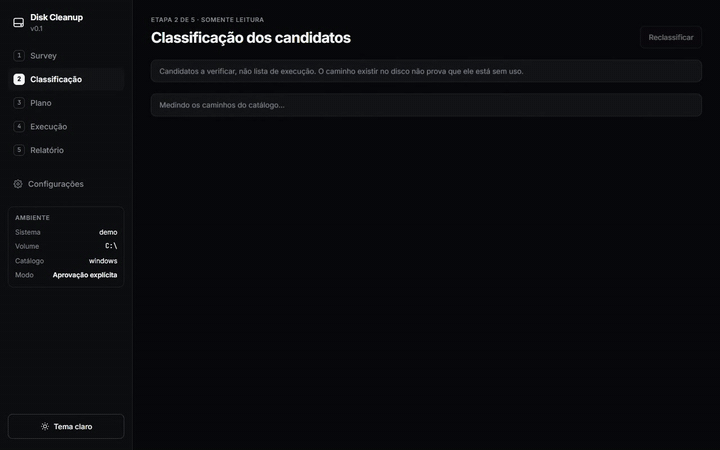
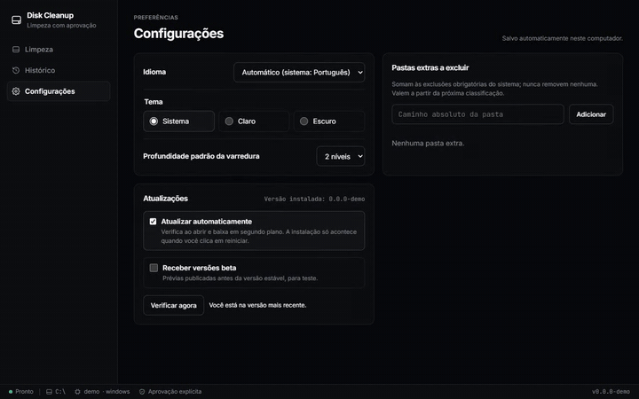
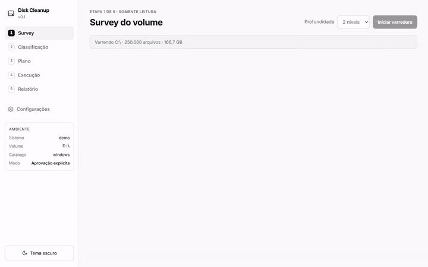
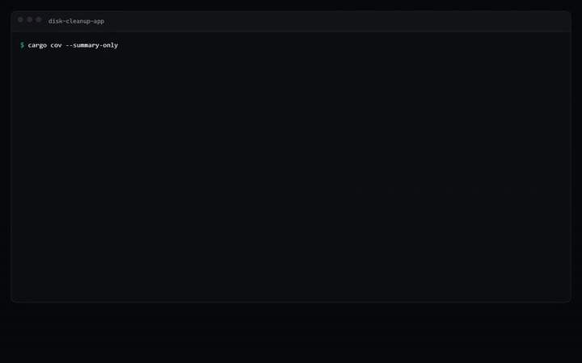

<h1 align="center">
   Disk Cleanup
</h1>

<p align="center">
  
  
  
  
  
</p>

<p align="center">
  <sub><a href="README.md">English</a> · <b>Português (Brasil)</b></sub>
</p>

<h2 align="center">De "meu disco está cheio" a um plano verificável.</h2>

<p align="center">
  Mede o volume inteiro numa varredura paralela, separa o espaço real dos placeholders de nuvem,
  classifica o que é seguro limpar, monta um plano revisável e o executa tier a tier. Nada é apagado sem medição e sem
  aprovação explícita.
</p>

<h3 align="center"><a href="../../releases"><ins>Download</ins></a> &nbsp;·&nbsp; <a href="docs/architecture.md"><ins>Arquitetura →</ins></a></h3>

<p align="center">
  
</p>

## Funcionalidades

<table>
<tr>
<td width="50%" valign="middle">

### Survey do volume

Uma única varredura paralela alimenta todas as visões: raízes, segundo nível e perfil do usuário.
Pastas de nuvem (OneDrive, Google Drive, Dropbox, iCloud) mostram tamanho **lógico × real**, para
60 GB de placeholders não serem confundidos com 60 GB em disco. Pastas sem acesso são contadas,
não escondidas.

</td>
<td width="50%">
  
</td>
</tr>
<tr>
<td width="50%" valign="middle">

### Classificação e plano

Um catálogo em dados (`catalog/windows.toml`) transforma caminhos em candidatos em quatro tiers —
cache, desinstalar, diretórios regeneráveis, sistema. Exclusões obrigatórias (`Windows\Installer`,
`WinSxS`, `Package Cache`…) nunca entram num plano, e ferramenta ainda referenciada pelo `PATH` ou
por variável monitorada (ex.: `CUDA_PATH`) fica **bloqueada**. O plano exporta um `plan.json`.

</td>
<td width="50%">
  
</td>
</tr>
<tr>
<td width="50%" valign="middle">

### Execução e relatório

Aprove o plano tier a tier, leia o dry-run, confirme e acompanhe cada item rodando, com o espaço livre
medido antes e depois dele. Arquivo travado nunca aborta o tier — vira pendência. A remoção nunca
segue link simbólico nem junção, e pastas amplas ou protegidas (raiz do volume, perfil,
`Program Files`…) são recusadas mesmo que o catálogo peça. O relatório compara medido × previsto por
tier, lista divergências e pendências e é copiado em Markdown.

</td>
<td width="50%">
  
</td>
</tr>
<tr>
<td width="50%" valign="middle">

### Configurações e idiomas

Português e inglês no app inteiro — inclusive os motivos e erros que vêm do núcleo Rust, que agora
fala em códigos que a interface traduz. **Automático** segue o idioma do sistema. O tema segue o
sistema ou fica claro/escuro, pastas extras podem ser protegidas além das exclusões obrigatórias, e
a profundidade padrão da varredura fica salva.

</td>
<td width="50%">
  
</td>
</tr>
<tr>
<td width="50%" valign="middle">

### Claro e escuro

Visual neutro e profissional nos dois temas. Segue a preferência do sistema e lembra a sua escolha.

</td>
<td width="50%">
  
</td>
</tr>
<tr>
<td width="50%" valign="middle">

### Testado por construção

Arquitetura limpa em Rust (domínio → aplicação → infraestrutura) e Vue, feita com TDD. Os portões de
cobertura falham o build abaixo de 95%: hoje o núcleo Rust está em 98,9% das linhas (99 testes) e a
interface em 100% das linhas (105 testes).

</td>
<td width="50%">
  
</td>
</tr>
</table>

## Estado

| Etapa | Estado |
|---|---|
| 1. Survey | pronto |
| 2. Classificação | pronto — catálogos de Windows, Linux e macOS (tiers A e C) |
| 3. Plano e aprovação | pronto — `plan.json` no formato da skill `disk-cleanup` |
| 4. Execução | pronto — caminhos e comandos; desinstaladores (tier B), DISM e helper elevado são o próximo passo |
| 5. Relatório | pronto — copiado em Markdown |

Cada sistema tem o próprio catálogo embutido (`catalog/windows.toml`, `linux.toml`, `macos.toml`) e as
próprias exclusões obrigatórias (pastas do sistema, bancos de pacotes, chaves, iCloud Drive, backups de
aparelhos). Os catálogos de Linux e macOS seguem os caminhos documentados das plataformas e ainda
precisam de validação em máquinas reais.

## Instalação

Os pacotes são gerados **só pelo GitHub Actions** e anexados a cada release.

| SO | Pacote |
|---|---|
| Windows x64 | `disk-cleanup_X.Y.Z_windows_x64-setup.exe` (por usuário, sem pedido de administrador) |
| Linux x64 | `.deb`, `.rpm` ou `.AppImage` (Ubuntu 22.04+ ou equivalente) |
| macOS | `.dmg` para Apple Silicon (`arm64`) ou Intel (`x64`) |

A imagem de macOS não é assinada com Apple Developer ID: na primeira abertura, clique com o botão
direito no app e escolha **Abrir**.

## Desenvolvimento

Requisitos: Rust stable, Node 20+ e pnpm. O trabalho local é teste e cobertura — **nenhum pacote é
gerado na máquina de desenvolvimento**.

```bash
# Núcleo Rust
cargo test --workspace
cargo cov --summary-only        # falha abaixo de 95% das linhas
cargo clippy --workspace --all-targets -- -D warnings

# Interface (apps/desktop)
pnpm install
pnpm test
pnpm coverage                   # falha abaixo de 95%
pnpm typecheck
pnpm dev                        # interface no navegador com dados de demonstração
```

Regenerar as mídias do README (dados de demonstração, gravados com o Edge instalado):

```bash
cd apps/desktop
pnpm exec vite build && pnpm exec vite preview --port 4173 &
node scripts/record-readme-media.mjs http://localhost:4173 ../../docs/assets/readme
```

Fluxo: teste primeiro (vermelho), código mínimo (verde), refatoração. Ver
[docs/architecture.md](docs/architecture.md).

## Releases

Release é uma tag anotada na `main`; a versão vem da tag. As skills do Claude Code
`disk-cleanup-release` (estável) e `disk-cleanup-release-beta` (canal beta) criam a tag e acompanham o
workflow `Release Desktop Packages`, que gera os pacotes de todos os SOs, verifica e publica. Detalhes e
o funcionamento da atualização automática: [docs/release.md](docs/release.md).

A **atualização automática** vem ligada: o app verifica ao abrir, baixa em segundo plano e só instala
quando você clica em **Reiniciar e atualizar**. Toda atualização é conferida por assinatura minisign.
Versões beta são opcionais (Configurações → Atualizações → *Receber versões beta*).

## Licença

Proprietário — todos os direitos reservados.
